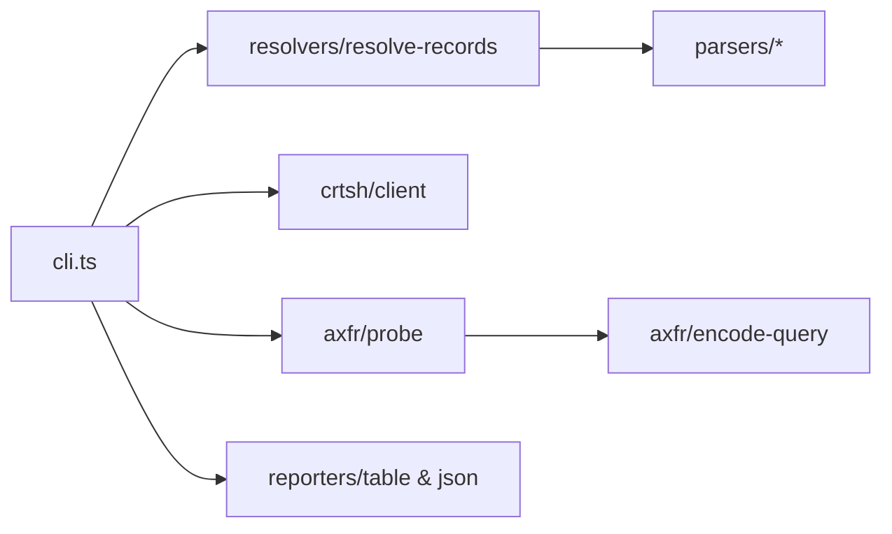

# hx-dns-recon-cli — architecture

## Purpose

Resolves DNS records, enumerates subdomains from Certificate Transparency, and probes
for AXFR misconfigurations on a given apex domain. Outputs engagement-ready text or
JSON. Non-goals: passive DNS historical archives, DNS brute force, or internal zone
walking.

## High-level flow

## Module map

| Path                               | Responsibility                                       |
| ---------------------------------- | ---------------------------------------------------- |
| `src/cli.ts`                       | `records`, `subdomains`, `axfr`, `recon` commands    |
| `src/index.ts`                     | Library entry re-exports                             |
| `src/types.ts`                     | DNS record and AXFR result types                     |
| `src/resolvers/resolve-records.ts` | Orchestrate record lookups for a domain              |
| `src/resolvers/node-resolver.ts`   | Node `dns.promises` wrapper                          |
| `src/resolvers/normalize.ts`       | Record normalization helpers                         |
| `src/parsers/*.ts`                 | Per-type record formatting (A, AAAA, MX, TXT, CNAME) |
| `src/parsers/format.ts`            | Shared formatting utilities                          |
| `src/crtsh/client.ts`              | crt.sh HTTP client and subdomain dedupe              |
| `src/axfr/probe.ts`                | NS discovery and AXFR attempt per nameserver         |
| `src/axfr/encode-query.ts`         | DNS wire encoding for AXFR queries                   |
| `src/reporters/table.ts`           | Human-readable console output                        |
| `src/reporters/json.ts`            | JSON serializers per command                         |

## Extension

1. Add a record type under `parsers/` and wire it in `resolve-records.ts`.
2. Add a reporter field in `reporters/json.ts` for new data.
3. Keep live DNS/crt.sh calls out of unit tests — mock at resolver or client boundary.
4. Run `npm test` and `npm run format:check`.

## Testing strategy

- **Unit**: parsers, normalizers, reporters, AXFR encoding — no live network.
- **Integration**: `jest.integration.config.js` — optional live domain probes.

## Ethics & scope

Authorized engagements only. See [SECURITY.md](./SECURITY.md).
